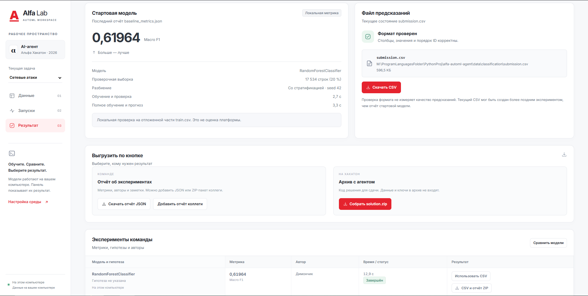
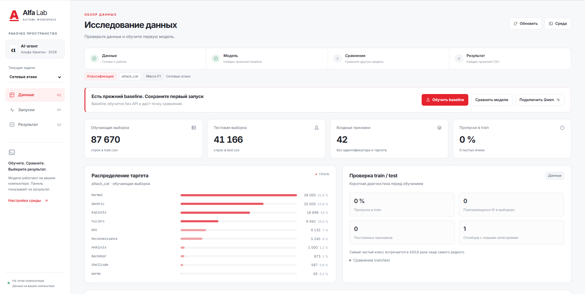
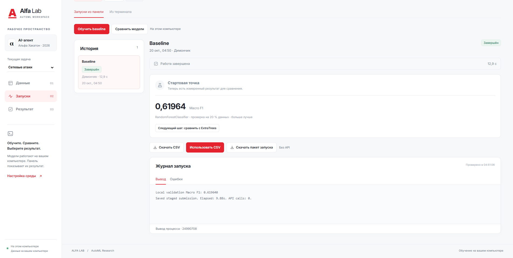

# Alfa AutoML Agent & Alfa Lab

Я сделал этот проект для хакатона «Альфа-Будущее» в октябре 2026 года. Это агент для табличных ML-задач и локальное приложение Alfa Lab, в котором можно запускать эксперименты и сравнивать результаты. Агент получает описание задачи и CSV, обучает модели и сохраняет предсказания в `submission.csv`.

Я занимался постановкой задачи, архитектурой, основной разработкой CLI и Alfa Lab, интеграцией компонентов и экспериментами. [Мурад Мамедов (Azeridevil)](https://github.com/Azeridevil) участвовал в разработке исторических признаков для регрессии, XGBoost-кандидата, проверках готовности данных и диагностике прогонов.

При разработке я использовал Codex и другие ИИ-инструменты. Изменения проверял тестами, локальными прогонами и CI.

Основной код написан на **Python 3.12**. Для работы с данными используются NumPy, pandas и SciPy; для обучения и поиска моделей scikit-learn, CatBoost, LightGBM и Optuna. Режим с LLM обращается к Qwen через OpenAI-совместимый API. Интерфейс Alfa Lab написан на HTML/CSS/JavaScript, локальный сервер на Python, desktop-окно на Tkinter.

В проекте мне было важно разделить подбор модели и проверку результата, уложить обучение в заданное время и сохранить рабочий ответ при ошибках моделей или API. В репозитории есть сборщик конкурсного архива, отчёты экспериментов и проверки для Windows и Linux.

[Быстрый запуск](#быстрый-запуск) · [Архитектура агента](#как-устроен-агент) · [Результаты и ограничения](#результаты-и-ограничения) · [Руководство Alfa Lab](app/README.md)



*Экран результатов ранней версии Alfa Lab; текущий интерфейс содержит дополнительные разделы.*

## Возможности

- **Локальный AutoML без API:** RandomForest / HistGradientBoosting, ExtraTrees, CatBoost, LightGBM и линейные модели; подбор параметров и преобразований признаков.
- **Адаптивный поиск в Alfa Lab:** Optuna TPE, измерение стоимости попыток, проверка финалистов и ансамбль из 2-3 моделей с весами, выбранными на внутренней выборке.
- **Исследование с Qwen:** генерация и запуск Python-кандидатов через OpenAI-совместимый API, журнал гипотез и обратная связь по внутренним экспериментам.
- **Проверка данных и результатов:** схема CSV, порядок ID и классов, временное разбиение, группы дубликатов, метрики и диагностика ошибок классификации.
- **Управление экспериментами:** отдельные каталоги запусков, последовательные серии, остановка, история, сравнение сопоставимых результатов и обмен отчётами.
- **Артефакты:** CSV, JSON/HTML-отчёты, рецепты обучения; отдельные фиксированные модели дополнительно сохраняют `.joblib` и паспорт модели.
- **GPU-эксперименты:** явный выбор GPU для отдельного CatBoost и отдельный эксперимент с официальным TabM, обучаемым с нуля.

TabM запускается отдельным CLI и пока не входит в автоматический конкурсный портфель. Экспорт обученного объекта AutoML-ансамбля в `.joblib` пока недоступен.

## Интерфейс Alfa Lab

| Раздел | Назначение |
| --- | --- |
| Обзор | Готовность данных, текущая работа, CPU/RAM/GPU компьютера |
| Данные | Состав таблиц, распределения и различия train/test |
| Эксперименты | Обучение одной модели, автоподбор, настройки и журналы |
| Серии тестов | Последовательные планы и сравнение бюджетов обучения |
| Проверка агента | Полные прогоны конкурсного CLI с проверкой происхождения результата |
| Результаты | Сопоставимые метрики, диагностика и выгрузка артефактов |

<details>
<summary>Скриншоты интерфейса</summary>

Скриншоты показывают одну из ранних версий лаборатории; текущий интерфейс содержит дополнительные разделы и настройки.





</details>

[Руководство Alfa Lab](app/README.md) описывает запуск серий, сравнение LightGBM, экспорт моделей и работу с GPU.

## Как устроен агент

1. **Контракт задачи.** Из `task.md` и `data_dictionary.csv` определяются метрика, цель, признаки и формат ответа.
2. **Разбиение данных.** Фиксируются внешняя проверка и внутренняя выборка для исследования. Для временных данных и дубликатов используются соответствующие ограничения разбиения.
3. **Исследование.** Локальный поиск или Qwen предлагает кандидатов. Параметры и веса ансамбля подбираются по внутренним результатам.
4. **Фиксация и проверка.** Управляющий процесс фиксирует рецепт, проверяет кандидата на внешней выборке и самостоятельно пересчитывает метрику.
5. **Обучение и публикация.** Допущенный рецепт обучается на полном train, предсказывает исходный test и публикует проверенный CSV.

Исходный дедлайн охватывает исследование и финальные стадии; для проверки и итогового обучения резервируется время. API-попытки и выполненные процессы отражаются в отчётах. Предусмотрены восстановление принятого результата и явные предупреждения при сохранении выхода с непроверенным качеством.

Пределы RSS наблюдаются по дереву процессов. Запуск исследовательского Python-кода не является полноценной системной песочницей.

### Где искать код

| Путь | Назначение |
| --- | --- |
| [`solution.py`](solution.py) | Конкурсная точка входа и выбор режима |
| [`agent/`](agent/) | Контракт задачи, модели, поиск, исследование и финализация |
| [`app/`](app/) | Alfa Lab, менеджеры запусков, интерфейс и экспорт |
| [`research_lab/`](research_lab/) | Локальные бенчмарки и экспериментальные исследования |
| [`tests/`](tests/) и [`app/tests/`](app/tests/) | Проверки ядра и приложения |
| [`build_submission.py`](build_submission.py) | Сборка плоского конкурсного ZIP |
| [`docs/`](docs/) | Протоколы, измерения и ограничения |

## Быстрый запуск

Нужны Git и **Python 3.12**. Команды выполняются из корня клонированного проекта. Node.js для запуска приложения не требуется.

### Windows · PowerShell

```powershell
git clone https://github.com/NolReaction/alfa-automl-agent.git
cd alfa-automl-agent
& "C:\Windows\py.exe" -3.12 -m venv .venv
& ".\.venv\Scripts\python.exe" -m pip install -r requirements.txt
& ".\.venv\Scripts\python.exe" solution.py --check
```

Полный путь к Windows Python Launcher помогает избежать подмены команды `py` другой программой. Если Python установлен иначе, используйте путь к своему интерпретатору 3.12.

Скачать обе публичные задачи организаторов и открыть лабораторию:

```powershell
& ".\.venv\Scripts\python.exe" prepare_data.py all
& ".\.venv\Scripts\python.exe" app/desktop.py
```

Для загрузки данных нужен интернет. Обычные модели обучаются локально без API-ключа. Уже скачанные полные файлы повторно не загружаются. После настройки окружения приложение также открывается через `app/AlfaLab.exe`; это запускатель существующей `.venv`, а не автономный установщик.

### macOS / Linux

```bash
git clone https://github.com/NolReaction/alfa-automl-agent.git
cd alfa-automl-agent
python3.12 -m venv .venv
.venv/bin/python -m pip install -r requirements.txt
.venv/bin/python solution.py --check
.venv/bin/python prepare_data.py all
.venv/bin/python app/server.py --open
```

Desktop-окно использует Tkinter; браузерный запуск через `app/server.py --open` доступен отдельно. По умолчанию данные находятся в `data/`, а история Alfa Lab в `app/.workspace/`. Для отдельных каталогов у `app/desktop.py` есть параметры `--data-dir` и `--state-dir`.

## Запуск из CLI

Пример локального исследования без API с явным лимитом в 10 минут:

```powershell
& ".\.venv\Scripts\python.exe" solution.py data/regression/task.md --mode offline --time-budget 600
```

Для классификации используется `data/classification/task.md`. На macOS/Linux префикс команды заменяется на `.venv/bin/python`.

Результат сохраняется в `submission.csv` рядом с `task.md`, а отчёты в `.agent_runs/` этой задачи. Поддерживаются RMSE, MAE, MSE, R2, Macro F1, Weighted F1, Accuracy, ROC AUC и LogLoss. Входной CSV-контракт и объявления метрик описаны в [руководстве](docs/offline_automl.md).

Лимит CLI по умолчанию составляет **10 500 секунд**. Это верхняя граница, а не обязательная длительность обучения. В длинном стандартном native-поиске допускается до 64 попыток; явный `--research-search adaptive-budget` увеличивает предел до 256 в пределах того же дедлайна. Новые полные очереди Alfa Lab выбирают этот режим автоматически.

### Исследование с LLM

Скопируйте `.env.example` в локальный `.env` и задайте `OPENAI_API_KEY`, `OPENAI_BASE_URL` и при необходимости `OPENAI_MODEL`. Затем явно выберите режим:

```powershell
& ".\.venv\Scripts\python.exe" solution.py data/regression/task.md --mode llm --max-steps 4 --time-budget 600
```

Режим LLM обращается к внешнему API и расходует его бюджет. Конкурсный режим `auto` читает настройки из окружения платформы. Для официальных шлюзов реализовано ограниченное переключение при временных ошибках; произвольные адреса не получают автоматических резервных получателей ключа. [Настройки и ограничения платформы](docs/platform_submission.md).

Ключи, `.env`, исходные датасеты, локальные результаты и обученные модели не включаются в репозиторий.

## Проверка и сборка

```powershell
& ".\.venv\Scripts\python.exe" dev_check.py
& ".\.venv\Scripts\python.exe" -m unittest discover -s app/tests -q
& ".\.venv\Scripts\python.exe" build_submission.py
```

Сборщик создаёт `solution.zip`: корневые Python-файлы и официальный `requirements.txt`. Пакет `agent/` преобразуется в плоскую структуру, чтобы импорты работали после переноса файлов платформой. Локальный интерфейс и данные в архив не входят.

На объединённой версии от **25 октября 2026 года** общий локальный прогон ядра выполнил **1907 тестов без ошибок**, 23 теста были пропущены по платформенным и необязательным возможностям. CI проверяет приложение, ядро, плоский архив и отдельные адаптеры на Windows/Linux. Проверки API в основном наборе используют локальную имитацию и не расходуют внешний API-бюджет.

## Результаты и ограничения

Я довёл проект до воспроизводимого конкурсного архива и локальной лаборатории для обучения и сравнения моделей. Локальные метрики зависят от разбиения: случайную проверку, временной holdout и группы дубликатов нельзя напрямую ранжировать как один эксперимент.

Внешняя метрика, участвующая в выборе финального кандидата, остаётся оценкой на разработческой выборке. Она не подтверждает качество на скрытом тесте или прирост баллов хакатона. Историю попыток, причины остановки и происхождение опубликованного результата сохраняют отчёты.

Подробнее о принятых решениях и результатах:

- [Research v3](docs/research_v3.md): как разделены исследование, внешняя проверка и финальное обучение.
- [Сравнение моделей](docs/expanded_validation.md): локальные измерения и ограничения сравнения.
- [Разбор полного native-прогона](docs/native_f6b3e851_review.md): предел поиска, пропущенные кандидаты и исправления.
- [TabM на CPU/CUDA](docs/tabular_neural_experiment.md): отдельное окружение, обучение с нуля, сохранение и загрузка весов.
- [Руководство Alfa Lab](app/README.md): эксперименты, серии, диагностика, модели и отчёты.
