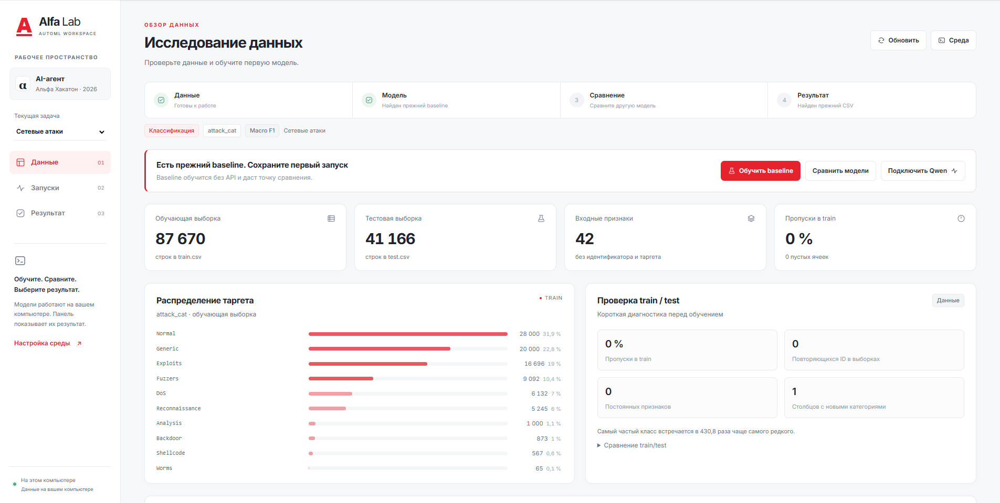
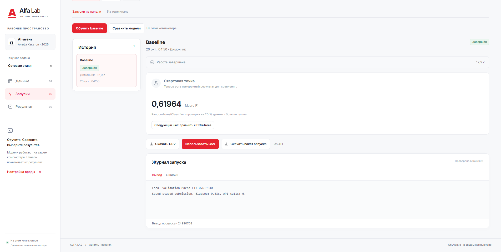
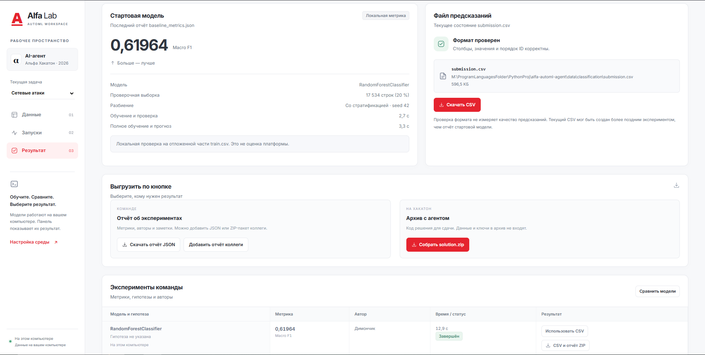

# AI-агент для хакатона Альфа-Будущее

Я Дима, капитан команды. Здесь собираем решение для табличных ML-задач: оно обучает модели, сравнивает их на локальной проверке и сохраняет предсказания в `submission.csv`. Автоподбор работает без API; Qwen пишет и запускает Python-код через API. Конкурсный запуск автоматически использует параметры API из окружения. Для локального автоподбора без API указываем `--mode offline`.

## Alfa Lab — приложение команды

В Alfa Lab можно работать с данными и запускать эксперименты из браузера: включить автоподбор, отдельно обучать baseline, ExtraTrees, CatBoost, LightGBM и линейную модель, смотреть этапы и журналы, сравнивать метрики, выбирать предсказания и обмениваться отчётами. После настройки API здесь же запускается исследование с Qwen.

| Экран | Для чего нужен |
| --- | --- |
| Данные | Посмотреть состав таблиц, распределение классов и различия train/test |
| Запуски | Обучить модель, увидеть результат проверки и следующий шаг |
| Результат | Сравнить эксперименты, скачать CSV и отчёт, собрать конкурсный `solution.zip` |

После [подготовки окружения](#как-запустить-у-себя) на Windows откройте `app/AlfaLab.exe` двойным кликом. Откроется окно управления и панель в браузере. EXE использует Python и библиотеки из `.venv` проекта. Можно также открыть `app/start-app.bat` или выполнить из корня проекта:

```powershell
.\.venv\Scripts\python.exe app/server.py --open
```

Для первого знакомства выберите задачу → **«Автоподбор»** → **«Запустить»**. Программа сохранит начальный результат, сравнит разные семейства моделей, уточнит параметры и отдельно проверит финальных кандидатов. Этапы, время и победитель видны в таблице. В разделе **«Результат»** нажмите **«Использовать CSV»**, чтобы сделать его текущим. Все обычные модели и автоподбор работают без API; Qwen расходует общий бюджет команды.

В автоподборе схема проверки выбирается автоматически; её можно указать вручную. Доступны случайная проверка, последний период для регрессии и группы одинаковых строк для классификации. Сравнивайте модели при одинаковой схеме; её название и параметры сохраняются в истории и отчётах. [Подробнее о выборе проверки](app/README.md#выбор-проверки-модели).

Для нового эксперимента нажмите **«Изменить настройки»** у завершённого запуска: рецепт и проверка перенесутся, а параметры модели можно изменить перед обучением. Каждый вариант сохраняется отдельно вместе с метрикой и настройками. В «Результате» у каждой схемы проверки своя группа сравнения. [Как работать с настройками](app/README.md#эксперименты-с-настройками).

В завершённом запуске классификации блок **«Где ошибается модель»** показывает F1 по классам, число примеров, основные пары ошибок и матрицу. Это помогает выбрать следующий эксперимент по конкретным ошибкам. [Как читать разбор](app/README.md#где-ошибается-классификатор).

Каждый участник запускает свою локальную лабораторию. **«Скачать пакет запуска»** сохраняет ZIP с CSV и отчётом; коллега добавляет его через **«Добавить отчёт коллеги»**, без распаковки. Автоматической синхронизации между компьютерами пока нет.

Подробности: [инструкция Alfa Lab](app/README.md) и [устройство автоподбора](docs/offline_automl.md). [Сравнение пяти семейств на нескольких разбиениях](docs/expanded_validation.md) содержит новые измерения; это отдельная проверка базовых конфигураций. История находится в `app/.workspace/`: сохраняйте её при обновлении приложения. На конкурс сдаём архив агента; панель в него не включается.

Скриншоты ниже показывают прежние экраны лаборатории; таблица автоподбора в них ещё не представлена.

### Данные — состав таблиц и распределение классов



### Запуски — обучение, метрика и следующий шаг



### Результат — сравнение экспериментов и выгрузка



## Что сейчас

- Добавлен автономный автоподбор через `solution.py` и Alfa Lab; расширенное ядро и приложение проверены на Windows/Linux. Измерения моделей и ограничения сравнения описаны в [отчёте](docs/expanded_validation.md).
- Для поддерживаемых метрик режим Qwen использует [research v3](docs/research_v3.md): исследование видит только outer-fit, выбирает рецепт на внутренней проверке, после фиксации host отдельно выполняет внешнюю проверку и полное обучение. В Alfa Lab видны шесть стадий и назначение метрик. Отдельные файлы не являются OS-песочницей.
- Ключ команды получен 20 октября. Прежний протокол v2 с настоящим Qwen прошёл полный цикл на небольшой контрольной задаче из плоского ZIP: изучил данные, обучил модель, улучшил проверяемую метрику и сохранил корректный CSV. Это проверка старой интеграции, а не нового v3 или качества на скрытом тесте. Ключ хранится только в локальном `.env` или окружении процесса.
- По сообщению организаторов решение нужно сдать до 26 октября. Точный час уточняю. Наша цель: готовый архив 25 октября.

Наши стартовые результаты на Windows, разбиение 80/20, `random_state=42`:

| Задача | Локальная метрика | Полный запуск |
| --- | --- | --- |
| Регрессия | RMSE: 44.651289, меньше лучше | 4.0 с |
| Классификация | Macro F1: 0.619640, больше лучше | 8.8 с |

Это результаты на случайной проверке из `train.csv`, а не результаты нового автоподбора. Их нельзя напрямую сравнивать с проверкой по времени или группам дублей. Первая отправка на платформу получила 0; без журнала выполнения причина неизвестна. Эти локальные метрики не позволяют вычислить платформенный балл.

## Кто что делает

| Кто | Направление | Рабочая ветка |
| --- | --- | --- |
| Дима + Codex | Протокол v3, общий guard, интеграция, CLI и Alfa Lab | `work/dima-research-v2` |
| Ника | Чистая политика контекста и следующего шага | `work/nika-research-policy` |
| Таня | Портфель рецептов при равном бюджете поиска | `work/tanya-model-recipes` |
| Мурад | Явно включаемый кандидат истории прошлых периодов | `work/murad-history-v2` |

Точные границы файлов и интерфейсы v1 закреплены в [заданиях команды](https://github.com/NolReaction/alfa-automl-agent/tree/bb1e4592ffe59cb62a84e49fd382de484bf04c3f/docs/team). Модули подключаются отдельными PR в порядке policy → portfolio → history; наличие файла не включает расширение автоматически.

Каждого прошу написать в Telegram: когда подключишься, что берёшь первым и что мешает. Ключ не нужен для работы с данными, обучения обычных моделей и локальных тестов.

## Как работаем

1. Перед началом обновляем `main` и создаём свою ветку, например `work/nika-qwen`.
2. Пишем в Telegram, какую задачу и какие файлы берём. Если нужен файл, который уже меняет другой человек, сначала договариваемся.
3. Работаем в своей ветке. Коммиты пишем понятно на русском: что конкретно изменили.
4. Выполняем `dev_check.py` и открываем Pull Request в `main`. В описании указываем результат, команду проверки и оставшиеся проблемы. Я собираю изменения в `main`.
5. Если застряли, сразу присылаем команду запуска и полный текст ошибки. Когда работаем вместе, заходим в нашу комнату в Контур Толке.

В Git отправляем код и инструкции. `.env`, данные, результаты запусков и обученные модели в репозиторий не добавляем.

## Как запустить у себя

Клонируем [репозиторий](https://github.com/NolReaction/alfa-automl-agent) через PyCharm или Git. Нужен Python 3.12. Команды выполняем из корня проекта.

На Windows в PowerShell:

```powershell
py -3.12 -m venv .venv
.\.venv\Scripts\python.exe -m pip install -r requirements.txt
.\.venv\Scripts\python.exe dev_check.py
```

Если `.venv` уже создана на Python 3.12, первую команду пропускаем. В PyCharm выбираем интерпретатор проекта `.venv\Scripts\python.exe`. Активировать окружение в терминале не нужно.

На macOS/Linux:

```bash
python3.12 -m venv .venv
.venv/bin/python -m pip install -r requirements.txt
.venv/bin/python dev_check.py
```

Ожидаем `true` у версии Python, пакетов и `python_child`, затем `OK` после тестов. До получения ключа поля `api_settings_present` могут быть `false`. Эти проверки не обращаются к Qwen и не расходуют токены.

`dev_check.py` проверяет окружение, выполнение Python, обучение, сохранение CSV и восстановление после ошибок. Для тестов используется локальная имитация API. Эти же проверки настроены в GitHub Actions на Windows и Linux; результат смотрим во вкладке Actions.

## Где взять данные

[Папка организаторов с материалами задач](https://drive.google.com/drive/folders/1eUjfuovujgEoUbtotU9uRGWLo-RacY3T?usp=sharing).

Первую задачу скачиваем одной командой. Скрипт сам создаёт нужные папки и проверяет размеры файлов, столбцы, число строк и ID:

```powershell
.\.venv\Scripts\python.exe prepare_data.py regression
```

Для обеих задач используем `prepare_data.py all`. Если загрузка оборвалась, повторяем команду: уже скачанные файлы нужного размера сохраняются. Для скачивания нужен интернет; API-ключ не нужен.

Если скачиваем вручную, раскладываем файлы так:

| Задача | Условие | Папка для CSV |
| --- | --- | --- |
| Регрессия | `data/regression/task.md` | `data/regression/regression/participants/` |
| Классификация | `data/classification/task.md` | `data/classification/multiclass/participants/` |

В каждой папке для CSV должны быть свои `train.csv`, `test.csv`, `data_dictionary.csv`, `sample_submission.csv`. Вложенность сохраняем: именно такие относительные пути указаны внутри `task.md`.

## Автоподбор без API

После загрузки данных запускаем нужную задачу:

```powershell
.\.venv\Scripts\python.exe solution.py data/regression/task.md --mode offline
.\.venv\Scripts\python.exe solution.py data/classification/task.md --mode offline
```

Явный `--mode offline` запускает подбор по нескольким семействам: RandomForest/HistGradientBoosting, ExtraTrees, CatBoost, LightGBM и линейная модель. Общий лимит по умолчанию — 10 минут. Параметры подбираются на внутренней выборке; финалисты проверяются на отдельном holdout. Четверть времени резервируется на финальное обучение; готовый начальный CSV сохраняется до завершения поиска. API не вызывается, даже если окружение и `.env` уже заполнены.

Без `--mode` действует конкурсный режим `auto`: при наличии `OPENAI_API_KEY` и `OPENAI_BASE_URL` в окружении запускается Qwen; без настроек или при неполных настройках включается явно обозначенный offline fallback. Если создание API-клиента в `auto` завершается ошибкой, локальный поиск получает остаток исходного бюджета. `OPENAI_MODEL` необязателен: по умолчанию `qwen/qwen3.8-27b`, а конкурсный прокси может заменить его моделью задачи. Локальный `.env` читается только в явном `--mode llm` и проверках окружения/API. [Контракт платформы и ограничения первой отправки](docs/platform_submission.md).

Результат — `submission.csv` рядом с `task.md`. Сводка попыток и проверочные предсказания находятся в `.agent_runs/<номер запуска>/automl_report.json` и `holdout_predictions.csv`. В командной строке успешный запуск заменяет текущий CSV результатом этого автоподбора. В Alfa Lab выбор текущего CSV выполняется отдельной кнопкой.

Поддерживается табличный CSV-контракт с `train.csv`, `test.csv`, `data_dictionary.csv`, `sample_submission.csv` и явно указанной метрикой: RMSE, MAE, MSE, R2, Macro F1, Weighted F1, Accuracy, ROC AUC или LogLoss. Тип задачи определяется метрикой: числовые классы сохраняются как метки. Для вероятностей проверяются порядок классов, диапазон и сумма. Нестандартные форматы требуют отдельного адаптера. [Лимит времени, выбор проверки и обработка ошибок](docs/offline_automl.md).

Прежний одиночный baseline тоже доступен:

```powershell
.\.venv\Scripts\python.exe offline_baseline.py data/regression/task.md
```

Он использует случайную проверку 80/20 и пишет `baseline_metrics.json`. Для замены существующего `submission.csv` ему нужен флаг `--overwrite`.

## Подключение API

Ключ передаём участникам лично, в репозиторий его не загружаем. У каждого в корне проекта должен быть локальный файл `.env`: копируем `.env.example`, если `.env` ещё нет, и заполняем данными организаторов. Уже заданные переменные окружения имеют приоритет над `.env`.

```dotenv
OPENAI_API_KEY=ключ_организаторов
OPENAI_BASE_URL=https://changellenge.up.railway.app/v1
OPENAI_MODEL=qwen/qwen3.8-27b
```

Проверка подключения на Windows:

```powershell
.\.venv\Scripts\python.exe solution.py --check-api
```

Команда делает один короткий запрос. `OPENAI_MODEL` можно не указывать. У всей команды общий бюджет 600 рублей в день; сброс в 03:00 МСК. Полные прогоны согласуем в Telegram, чтобы не запускать одинаковую работу одновременно. Адрес выше используется локально; на платформе адрес и ключ берутся из выданного ею окружения.

После успешной проверки начинаем с ограниченного исследования нужной задачи:

```powershell
.\.venv\Scripts\python.exe solution.py data/regression/task.md --mode llm --max-steps 4 --time-budget 300
.\.venv\Scripts\python.exe solution.py data/classification/task.md --mode llm --max-steps 4 --time-budget 300
```

На macOS/Linux заменяем `.\.venv\Scripts\python.exe` на `.venv/bin/python`.

Результат каждой задачи: `submission.csv` рядом с её `task.md`. Код экспериментов и их вывод: `.agent_runs` в той же папке. Для девяти поддерживаемых метрик управляющий процесс сам проверяет качество на закреплённой выборке из `train.csv`.

## Что делает режим Qwen

1. Host закрепляет внешнее разбиение и исходные ответы. В рабочую папку попадает только outer-fit и внутреннее разбиение. Task.md содержит проверенные объявления и короткий обзор исходного условия; полное очищенное описание доступно в `task_description.md`. Ссылки на CSV ведут в разрешённое представление. Исходные test и outer-ответы исследователю не передаются.
2. Существующий AutoML ищет стартовый рецепт только на этом представлении. Qwen получает параметры, внутреннюю selection-метрику и агрегированную диагностику ошибок. Резерв на внешнюю проверку и полное обучение растёт по измеренному времени выполнения рецептов; оценка учитывает оба финальных обучения и не является гарантией длительности.
3. Qwen сохраняет `research_hypothesis.json`, `research_recipe.json` и `research_candidate.py` с функцией `fit_predict(X_fit, y_fit, X_predict, context)`. Host фиксирует копию, исполняет её в отдельном процессе на inner-fit/inner-validation и сам считает метрику. Вероятности требуют явного порядка классов. Старые артефакты удаляются перед каждым tool call.
4. После завершения диалога фиксируются хеши выбранного кода и рецепта. Host оценивает baseline и кандидата на внешней части; после этого API больше не вызывается. Выбор по outer явно отмечается: оценка победителя не является несмещённой независимой оценкой системы.
5. Host обучает допущенный неизменный рецепт на полном train и проверяет исходные test ID/CSV. Сначала сохраняется полный результат baseline, затем улучшивший его кандидат; неудачный refit сохраняет последний действительно принятый CSV. Без такого CSV успешного статуса нет.

При временной транспортной ошибке, HTTP 5xx или 429 без признаков исчерпанной квоты допускается один повтор API на весь v3-запуск. Он учитывается как отдельный запрос и снова проходит ограничения времени, числа запросов и контекста. Ошибки авторизации, баланса и уже полученные некорректные ответы не повторяются. После отказа результат автономного пути помечается `fallback`. Guard ограничивает число requests, размер запроса и оценочный суммарный объём с резервом ответа; оценка не является фактическим usage или стоимостью. Для неизвестной метрики сохранён явно помеченный legacy v2 путь с проверкой формата и `host_metric_unsupported`; гарантии v3 на него не распространяются.

Перед основным обучением `solution.py` готовит дешёвый аварийный CSV для исходного test: медиану/среднее полного train либо частоты классов. Подготовка получает не более 30 секунд и 5% остатка времени. Это резерв с непроверенным качеством, а не результат AutoResearch. Принятый основной результат имеет приоритет; восстановление проверяет исходные файлы и закреплённые хеши. [Устройство восстановления и состав релиза](docs/release_recovery_2026-10-21.md).

Обновление 21 октября: по ответу организаторов отправка в 03:39 завершилась,
но одна задача не превзошла бейзлайн и получила ноль. Предыдущая отправка в
21:54 не сохранила итоговые предсказания после ошибки. Итоговый public-балл
0,8282 не определяет, какая задача дала ноль и работал ли Qwen.

У `solution.py task.md` бюджет по умолчанию теперь 10500 секунд во всех
режимах, включая отсутствие API. `--time-budget` сохраняет явное ограничение.
После ошибки API, обрезанного ответа, лимита контекста/шагов или повторных
неудач агент может продолжить ограниченный локальный поиск в оставшееся
время; финальная проверка и полное обучение используют тот же дедлайн.

Экспериментальный `--search-profile strong_v1` предлагает более длительное
обучение CatBoost/LightGBM через прежние изолированные worker и nested
validation. По умолчанию остаётся `legacy`: новый профиль нельзя считать
лучшим до сравнения качества при равном бюджете. Пример автономного прогона:

```powershell
.\.venv\Scripts\python.exe solution.py data/regression/task.md --mode offline --search-profile strong_v1 --time-budget 1800
```

В `.agent_runs/<номер запуска>/run.json` сохраняются версия протокола, стадии, внутренние и внешние оценки, хеши рецептов, исполнение и публикация. `research_journal.json` содержит гипотезы и inner-результаты. Неизвестный usage не считается нулём; рублёвая стоимость не вычисляется. Старые отчёты читаются с прежним происхождением. Подробнее: [контракт и инварианты v3](docs/research_v3.md).

Для короткой проверки настоящего Qwen есть `experiment_research_smoke.py`. По умолчанию он только создаёт две небольшие синтетические задачи и проверяет наличие настроек, не вызывая API:

```powershell
.venv\Scripts\python.exe experiment_research_smoke.py
.venv\Scripts\python.exe experiment_research_smoke.py --execute --max-steps 4 --time-budget 300
```

На Linux используется `.venv/bin/python` с теми же аргументами. Явный `--execute` запускает задачи последовательно: максимум 4 запроса и 300 секунд на каждую, не более 8 запросов и 100k оценочных токенов на всю проверку. При ошибке API вторая задача не запускается. Настройки берутся из окружения или локального `.env`; ключ и endpoint в сводку не попадают. Результаты лежат в `data/experiments/research_smoke/`. Это проверка взаимодействия компонентов; качество на публичных или скрытых задачах она не измеряет. Общий суточный расход команды этим локальным счётчиком не определяется.

После ошибки API текущая задача может продолжить **ограниченный локальный поиск**:
до 12 новых рецептов, остановка после четырёх попыток без улучшения или при
достижении резерва финализации. Проверенные рецепты не повторяются. Исходный
baseline сохраняется; новые запросы API не выполняются. В отчёте это `fallback`
с отдельными `local_experiments` и `local_research`, а не успешная работа Qwen.
Smoke показывает безопасный тип сетевой ошибки в `api.errors`.

Для оценки качества всего offline-конвейера добавлен отдельный стенд без API:

```powershell
.venv\Scripts\python.exe benchmark_agent.py --seeds 42 --time-budget 90 --modes seed automl
```

Он создаёт шесть разных синтетических задач и оценивает готовый CSV по ответам,
которые не передаются решателю. `--full` использует три заранее заданных seed.
Экспериментальная политика `--search-policy adaptive_v1` раньше проверяет
разные семейства и варианты под метрику, использует host timings для допуска
очередной попытки и сохраняет резерв outer/full refit. Обычный запуск остаётся
на `legacy`. Опция доступна и для offline, и для Research v3, включая локальное
продолжение после отказа API. Переключение политики само по себе не подтверждает
рост качества: [протокол](docs/night_quality_protocol.md) и
[результаты независимой проверки](docs/night_quality_report.md) показывают
смешанный эффект. На confirmation выиграла MAE с тяжёлыми хвостами, signed MAE
ухудшилась; заранее заданный допуск нового default не пройден.

```powershell
.venv\Scripts\python.exe solution.py data/regression/task.md --mode offline --time-budget 180 --search-policy adaptive_v1
```

Повторные внутренние проверки финалистов (`--stability-splits 3`) и рецепты
под метрику (`--metric-recipes`) пока включаются явно; эти флаги принимают
`solution.py` и стенд. Подробности и ограничения: [офлайн-поиск и проверка качества](docs/offline_research_quality.md).

Полный конкурсный маршрут v3 при имитированном отказе API проверяется отдельно:

```powershell
.venv\Scripts\python.exe benchmark_agent.py --cases nonlinear_regression imbalanced_binary --seeds 42 --modes research_api_failure --time-budget 180
```

Подменяется только API-клиент: настоящий startup, локальная очередь и финальное
обучение работают без заглушек. Внешних API-вызовов нет; две имитированные
неудачные попытки, включая один ограниченный повтор, учитываются отдельно. Режим требует подтверждённого локального обучения
и новой публикации, а пропуск этапа помечает как неполную проверку.
Три дополнительные MAE-задачи выбираются явно через `--cases mae_signed_nonlinear
mae_symmetric_linear mae_heavy_tailed`; прежние шесть задач по умолчанию сохранены.
Контракты, сравнение Windows и ограничения: [полный агент при отказе API](docs/research_failure_benchmark.md).

## Как собрать архив

```powershell
.\.venv\Scripts\python.exe build_submission.py
```

Получаем `delivery/solution.zip` размером до 100 МБ. Все файлы лежат в корне: `solution.py`, `agent.py`, плоские `_alfa_agent__*.py`, `offline_baseline.py`, `validation.py`, `requirements.txt`. Сборщик сохраняет обычные импорты `agent.*` через небольшой загрузчик; структура исходников в репозитории остаётся прежней. В ZIP файл `requirements.txt` содержит точную копию списка организаторов из `requirements.platform.txt`; для разработки используется компактный корневой `requirements.txt`.

Данные, ключи, результаты, тесты и приложение в архив не включаются. Кнопка конкурсной выгрузки Alfa Lab использует тот же сборщик. Проверка перед отправкой должна воспроизводить копирование только корневых `.py` и `requirements.txt`: платформа не переносит вложенные папки ZIP.

## Что проверяем перед сдачей

- Один и тот же агент должен работать с разными задачами без ручной настройки под конкретный датасет.
- Официальный кейс описывает агентную систему под управлением LLM, генерацию кода и цикл проверки гипотез. Offline-подбор — средство локальной разработки и резервный путь; его нельзя считать полным выполнением этого требования.
- По кейсу платформа даёт Python 3.12, 8 CPU, 32 GB RAM и до 3 часов на задачу. Код ограничивает время 175 минутами; offline по умолчанию использует 10 минут, Qwen — 12 шагов и 175 минут. Наши зависимости сверены с официальным списком, новые пакеты при запуске не устанавливаются.
- Проверяем распакованный архив на обеих задачах и корректность `submission.csv`. Если сдаём режим Qwen, нужен полный запуск с настоящим API. Успешные локальные тесты сами по себе не подтверждают результат на платформе.
- В итоговом ZIP все файлы лежат в корне. По обновлённой инструкции — 3 отправки в день на команду, сброс в 00:00 МСК. Отправку делаю я; оставшиеся попытки проверяю в форме. 03:00 МСК относится к бюджету API.
- Организаторы уточнили 21 октября: каждая задача получает отдельные 3 часа и отдельный каталог, результаты между запусками не передаются. Public и private оцениваются раздельно, каждый по среднему двух соответствующих задач. В приведённом ответе типы приватных задач не подтверждены.
